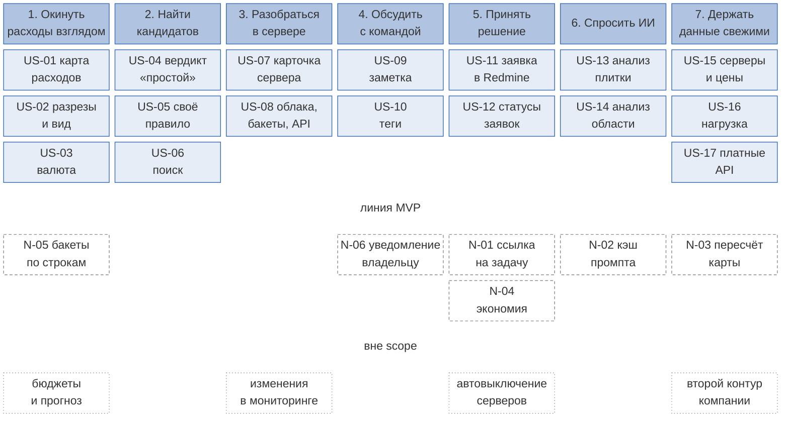

# User Story Map

Версия КТ-1, 13.11.2026. Слева направо идёт то, что делает пользователь, а сверху вниз срезы, то есть MVP, следующий срез и то, что не делаем. Всё, что выше линии MVP, уже сделано и работает в компании с 10.11.2026. Сами истории лежат в [stories.md](stories.md).

## Карта

Как читать: насыщенные синие карточки это активности, светлые синие это истории MVP, с пунктиром следующий срез, а с точками то, что не делаем.

### То же списком

| Активность | Актор | Шаги | MVP | Следующий срез | Вне scope |
|---|---|---|---|---|---|
| 1. Окинуть расходы взглядом | руководитель, инженер | открыть карту, выбрать разрез и валюту | US-01, US-02, US-03 | N-05 | бюджеты и прогноз |
| 2. Найти кандидатов | инженер | включить правило простоя, найти проект | US-04, US-05, US-06 | | |
| 3. Разобраться в сервере | инженер, руководитель | открыть карточку, посмотреть нагрузку | US-07, US-08 | | изменения в мониторинге |
| 4. Обсудить с командой | инженер | оставить заметку или тег | US-09, US-10 | N-06 | |
| 5. Принять решение | инженер → DevOps | оформить заявку, следить за статусом | US-11, US-12 | N-01, N-04 | автоматическое выключение серверов |
| 6. Спросить ИИ | инженер, DevOps | запустить анализ, прочитать вердикт | US-13, US-14 | N-02 | |
| 7. Держать данные свежими | система | синхронизировать серверы, цены и нагрузку | US-15, US-16, US-17 | N-03 | второй контур компании |

Результат между акторами передаётся в одной точке: заявка из US-11 уходит DevOps задачей в Redmine, а их решение возвращается на карту статусом в US-12. Активность 7 выполняет система по расписанию, а её результат остальные видят на карте.

Истории следующего среза описаны в конце [stories.md](stories.md). Задачи по ним и по курсовой копии лежат в [бэклоге](../backlog.md).

## Сквозные сценарии MVP

| ID | Сценарий | Путь по карте | Что в нём кроме CRUD |
|---|---|---|---|
| E2E-1 | Найти простаивающий сервер и попросить его вывести | US-01 → US-04 → US-07 → US-09 → US-11 → US-12 | правило простоя с окном и покрытием данных, исключения hotswap и резерва в группе; заявка проверяет месяц, повторы и тип цели, создаёт задачу во внешней системе и потом подтягивает её статус |
| E2E-2 | Проверить сервер через ИИ | US-07 → US-13 → US-11 | фоновая задача с состояниями «идёт», «готово», «ошибка» и «таймаут», не чаще раза в сутки на плитку, вердикт проходит проверку схемы |
| E2E-3 | Данные за час | US-15 → US-16 → US-01 | сопоставление серверов из мониторинга и счёта по IP и имени, цена из счёта за последние полные 30 дней |
